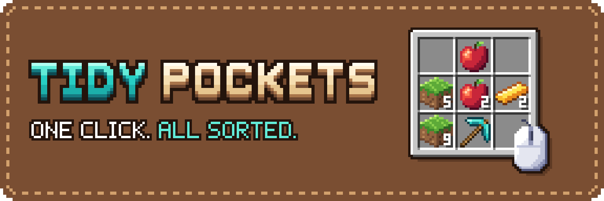
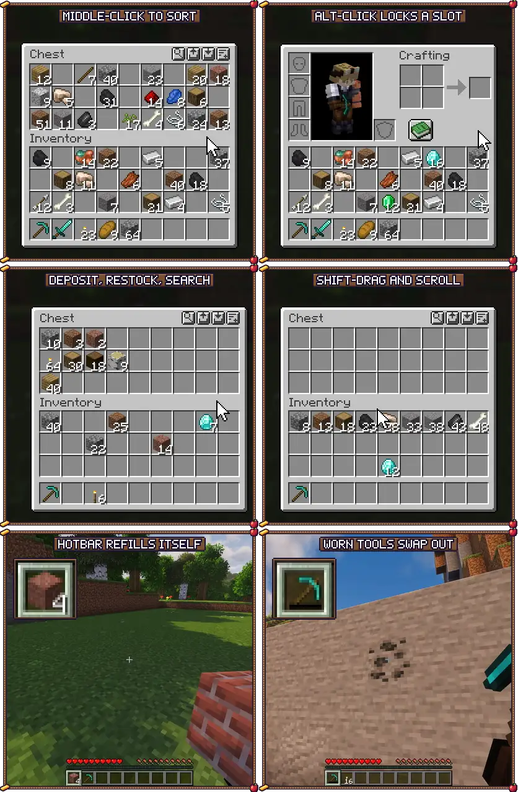

**One click, all sorted.** Instant inventory sorting, slot locking, hotbar refill, a random block palette, tool-break protection and mouse shortcuts in one client-side mod, with quick cartoon animations.

- **Instant sorting.** Middle-click any inventory, chest, barrel or shulker box. Tidy Pockets works out the finished layout and sends every click in the same frame, so the sort is done the moment you click. The animation just plays on top.
- **Slot locking.** Alt-click a slot and its item stays put: no shift-click, drop, swap or sort can move it.
- **Hotbar refill.** When the stack in your hand runs out, a matching stack from your inventory takes its place.
- **Random palette.** Press R over the hotbar blocks you want to mix. With one of them selected, every block you place comes from a random palette slot, so walls and floors get texture without you switching slots. It keeps like blocks apart, so the mix never turns patchy.
- **Tool-break protection.** A tool about to break is swapped for a spare or moved to your inventory, so it never breaks.
- **Mouse shortcuts.** Scroll to move items one at a time, shift-drag across slots to move many.
- **Container tools.** Sort, Deposit matching and Restock buttons on chests, and Ctrl+F to search. Hold Shift to deposit your whole main inventory or to take everything out.
- **Cartoon animations** for opening inventories, moving items and the hotbar. Each has its own toggle.

| Action | Default |
|---|---|
| Sort | Middle-click over an inventory |
| Lock or unlock a slot | Left Alt + click |
| Add or remove a block in the random palette | R over a hotbar block (or R with it selected) |
| Clear the random palette | Shift + R |
| Search | Ctrl+F in a container |
| Deposit everything / take everything | Shift + click Deposit or Restock |
| Move one item / a whole stack | Scroll wheel / Shift + scroll |
| Shift-click many slots | Hold Shift and drag |

Random palette: press R on each hotbar block you want to mix (a small die shows on it), then place blocks as usual. A block in two slots comes up twice as often. Select any other slot, like a torch, and placing is normal again.

Change the keys in Controls, and the settings in Mod Menu (Fabric) or the Mods list (NeoForge, Forge).

The settings open in the shared **Profet Mods** screen (also from the copper golem button in the Game Menu) with a live preview of every option and Quick setup presets. Its **Report bug** button sends a bug report from inside the game: what happened plus your Minecraft and loader versions, mod list, changed settings and recent errors. **Privacy:** reports go through Profet's report server (Cloudflare) and are posted as public issues on GitHub. Your player name, home folder and IP addresses are removed first, and a **View report** link shows exactly what will be sent. Nothing is sent unless you press Send.

- **Client-side only.** Works on any server, including vanilla servers and Realms.
- **Controller support** through Controlify (Fabric and NeoForge, 26.2 and 26.3): sort, lock, random palette and the container tools are bindings in Controlify's controls. Sort starts on a right-stick click. Only Sort has a default button; if another mod or your own setup already uses the right-stick click, change it under Tidy Pockets in Controlify's Controls, where the other actions can be bound too.
- Plays nice with Mouse Tweaks, Mouse Wheelie, Smooth Swapping, Smooth Scrolling and Inventory Profiles Next: the overlapping feature switches itself off.
- If a server's anti-cheat objects to instant sorting, turn on **Safe mode**.

Put the jar for your loader in your `mods` folder: Fabric or Quilt (needs Fabric API), NeoForge or Forge, for Minecraft 26.3, 26.2, 26.1.2, 1.21.11, 1.21.1 and 1.20.1. Minecraft 1.21.8 and 1.21.4 have Fabric and Quilt builds. On 1.20.1, NeoForge uses the Forge jar.

<!-- promo:start -->

<!-- promo:end -->

Tidy Pockets is free. If it saves you some inventory shuffling, a coffee helps fund the next update.

Want your own server to play on with friends? My BisectHosting affiliate link gives you 25% off the first month, and I get a small commission.

All rights reserved, with permissions: you can use it anywhere, include it in modpacks with credit, and show it in videos. Full terms: [LICENSE](https://github.com/ProfetGit/tidy-pockets/blob/main/LICENSE).

Not an official Minecraft product. Not approved by or associated with Mojang or Microsoft.

